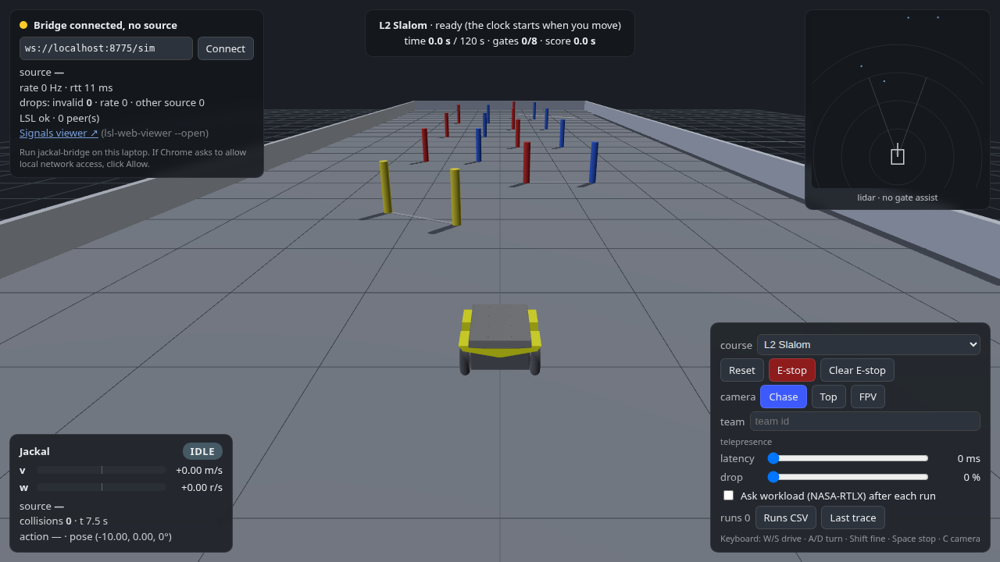

<!-- budget: 900 words above the event kit -->
<div align="center">



# Myo Lever Controller

*Drive a simulated Clearpath Jackal with one forearm: arm angle steers, a firm fist brakes.*

[](#the-award)
[](environment.yml)
[](https://github.com/ajbarea/Hackathon/releases/tag/dataset-2026-10-22)

</div>

---

Our team's entry to the AWARE-AI Fall Hackathon (RIT, October 22-23, 2026). The challenge: read a Myo
armband, turn it into forward speed and turn rate `(v, w)`, and drive a simulated Jackal through three
timed courses, then keep it drivable over a slow, lossy link. Our controller reads your forearm like a
lever: the armband's motion sensor sets speed and steering from the arm's angle, and its muscle (EMG)
signal decides one thing, a deliberate fist that brakes. A lidar assist slows before obstacles and
nudges you through gates you are already aimed at.

## The award

The team won **Best Presentation** at the AWARE-AI Fall Hackathon 2026. The deck is built from a
script that reads every number it shows from the recordings and drive logs
([`presentations/aware-ai-deck/`](presentations/aware-ai-deck/)).

## Results

From AJ's lever-mode drives (details and the commands that recompute them:
[`examples/MYO_LEVER.md`](examples/MYO_LEVER.md)). All 51 recorded runs, the blind-test runs included, finished
with 0 missed gates.

| Course | Runs | Median score | Collisions |
|---|---|---|---|
| L1 Gates | 4 | 20.73 s | 0 |
| L2 Slalom | 6 | 26.62 s | 0 |
| L3 Corridor + Dock | 4 | 16.26 s | 0 |

- **Slow link (300 ms lag, 10 % drop):** a blind test of lag compensation, 8 sessions with the
  condition hidden from the driver, gave better medians on score, smoothness and workload, but no
  difference was significant (p = 0.26 to 0.63). It stays on because it did no measurable harm.
- **Deep learning or not:** a causal temporal convolutional network (TCN) against the controller's
  linear discriminant (LDA), over four drivers. On each person's own calibration the LDA won for 3 of
  4 drivers (median accuracy 0.85 against 0.68), and neither generalised well to a driver it had never
  seen. See [`examples/TCN.md`](examples/TCN.md).

## Run it

You need a Myo armband, conda and Chrome. Quit Myo Connect first if it is running.

```bash
git clone https://github.com/ajbarea/Hackathon.git && cd Hackathon
conda env create -f environment.yml          # once, about 5 minutes
conda activate jackal
python examples/lever.py <your name>
```

It connects to our team's Myo by default (add `--addr nearest` for any other band), calibrates you
the first time (about 2.5 minutes of guided poses), opens the
sim in your browser and drives. Next time it skips straight to driving.

| Your arm | The robot |
|---|---|
| Forward, level | Goes. Lower your arm to go faster |
| Raised from the elbow | Stops |
| Rolled left or right | Turns |
| Tipped down | Reverses |
| Firm fist, held 0.4 s | Brakes |

No armband? Run `jackal-bridge --serve-site --open` and drive the sim with W, A, S and D, or
`python examples/fake_myo_lsl.py --emit-cmd` to drive it from synthetic EMG.

## The Myo data pipeline

```
Myo armband ──BLE──► myo_lsl_publisher.py ──LSL──► Myo_EMG (8 ch, 200 Hz) + Myo_IMU (10 ch, 50 Hz)
                                                      │
        calibration: myo_gestures.py record           ▼   six poses × 2, 3, 5 s takes, saved as CSV
        drive:       myo_gestures.py drive --mode lever
                       IMU  → arm angle → speed and steering (armdrive.py)
                       EMG  → 16 features → LDA: fist or not → brake (gestures.py)
                       lidar → slow before obstacles, gate nudge (armdrive.assist)
                                                      │  (v, w) at 20 Hz
                                                      ▼
                          jackal-bridge ──WebSocket──► browser sim (scores every run)
```

1. **Stream.** `myo_lsl_publisher.py` reads the band over the laptop's Bluetooth and publishes EMG and
   IMU on Lab Streaming Layer.
2. **Calibrate.** `myo_gestures.py record` prompts six poses (GO, STOP, LEFT, RIGHT, REVERSE, BRAKE),
   each held for 2, 3 and 5 s, and saves every take as CSV in `data/<name>-lever/`.
3. **Drive.** The accelerometer's gravity direction gives the arm's angle against your calibrated
   poses (never yaw, so it does not drift). EMG
   becomes 16 features per 200 ms window (log RMS and log waveform length per channel). A brake
   needs an LDA, trained on your own takes (or the pooled model in `data/brake-pooled.npz` when it
   exists), to read a fist, and the EMG level to pass a share of your calibrated fist level.
4. **Log.** Every drive writes `drives/drive_*.csv`: one row per 20 Hz command, with the arm angles,
   the EMG features, the command sent and course progress.

`lever.py` runs all of this, plus `jackal-bridge --serve-site --open`, in one command. Tests:
`pytest examples/tests`.

**Data.** AJ's recordings (two sessions, the sim's run CSVs and every drive log) are the
[`dataset-2026-10-22`](https://github.com/ajbarea/Hackathon/releases/tag/dataset-2026-10-22) release.

## Team

AJ Barea, Jose, Kiran and Xinyi Liu. Xinyi built the gate assist, the sim's lidar minimap, the
assist viewer and the pooled brake model (`train_pooled.py`); AJ wrote
the lever controller, the TCN study and the deck generator. The event kit below, the sim and the
bridge come from the organizers' [AHRTLab/Hackathon](https://github.com/AHRTLab/Hackathon) repo, which
this repo forks.

---

## The event kit

Everything below is the organizers' starter kit that every team began from.

### Start here

| | |
|---|---|
| **1. Set up and drive** (about 10 min) | [**STUDENT_GUIDE.md**](STUDENT_GUIDE.md): install, start the sim, drive, connect the Myo |
| **2. Write your controller** | Copy [**`examples/controller_template.py`**](examples/controller_template.py) and edit its two functions (below) |
| **3. Know how you're judged** | [**RUBRIC.md**](RUBRIC.md): judged runs, scoring, bonus points |
| Slides | [`presentations/`](presentations/): the kickoff, and **EMG On-Ramp** (new to EMG? start here) |
| Live sim | https://ahrtlab.github.io/Hackathon/ (Chrome), or offline: `jackal-bridge --serve-site --open` |

### Your code

You edit **one file**: your copy of `examples/controller_template.py` (e.g. `examples/my_team.py`).
Everything else (connecting to the bridge, sim state, 20 Hz timing, reconnects, stopping safely) is done
for you.

```python
SOURCE = "my-team"                      # your team name, shown in the sim's HUD

def my_input() -> dict:                 # read YOUR device: the Myo, your classifier's LSL stream, …
    ...

def step(state, inp, events) -> tuple[float, float]:
    ...                                 # decide: return (v, w) in m/s and rad/s (+ w = turn left)
```

```bash
python examples/my_team.py              # with jackal-bridge running and the sim open
```

`state` holds the robot's pose, speed, a 180-beam lidar scan and course progress; `events` says when
you pass a gate, collide or finish. Prefer another language? Send JSON to the bridge yourself:
[`protocol/PROTOCOL.md`](protocol/PROTOCOL.md).

#### Examples to learn from

| Example | What it shows |
|---|---|
| [`controller_template.py`](examples/controller_template.py) | **Copy this.** Fill in `my_input()` and `step()` |
| [`myo_emg_example.py`](examples/myo_emg_example.py) | Smallest Myo controller: read EMG → one feature → threshold → send |
| [`keyboard_teleop.py`](examples/keyboard_teleop.py) | Hold-to-drive window (keys or a gamepad) through the bridge |
| [`state_listener.py`](examples/state_listener.py) | Prints what your controller can read: pose, lidar, course progress, events |
| [`myo_lsl_publisher.py`](examples/myo_lsl_publisher.py) | Real Myo → LSL (`Myo_EMG`, `Myo_IMU`, `Myo_Events`) over built-in Bluetooth |
| [`fake_myo_lsl.py`](examples/fake_myo_lsl.py) | The same Myo streams with synthetic data (no armband needed) |
| [`myo_check.py`](examples/myo_check.py) | Can this laptop find and connect to a Myo? `--off` turns it off |
| [`terminal_teleop.py`](examples/terminal_teleop.py) | Smallest possible sender: tap keys in a terminal |
| [`autopilot_gates.py`](examples/autopilot_gates.py) | A reference autopilot (for testing the setup; not allowed in judged runs) |

**Signals and training data:** [`lsl-web-viewer`](https://github.com/AHRTLab/lsl-web-viewer) (installed
with the env): `lsl-web-viewer --open` shows every LSL stream on your laptop and records labeled takes as CSV.

---

### For staff and developers

**Running the event:** [`docs/RUNBOOK.md`](docs/RUNBOOK.md) (deploy, pre-event checklist, day-of,
judging, data, troubleshooting). Staff-only material (the baseline controller) lives in the gitignored
`staff/` folder; see the runbook.

**Repo layout.** `main` is always the **current** event. Each past event is a branch:

| Branch | Event |
|---|---|
| `main` | AWARE-AI 2026: Jackal sim + command bridge (current) |
| [`2026-bioradio`](https://github.com/AHRTLab/Hackathon/tree/2026-bioradio) | BioRadio Hackathon 2026: biosignal → ML classifier → control |
| [`myo-lsl-legacy`](https://github.com/AHRTLab/Hackathon/tree/myo-lsl-legacy) | Myo + LSL data collection (legacy) |

Starting a new event: branch `main` to the current event's name (e.g. `git branch 2026-aware-ai-jackal`,
then push it), then update `main` for the new event.

```
STUDENT_GUIDE.md  RUBRIC.md  presentations/  examples/   the event (students)
protocol/   the command/state contract (protocol/v1); start with protocol/PROTOCOL.md
web/        browser MuJoCo-WASM Jackal sim (Vite + TypeScript + three.js), deploys to GitHub Pages
bridge/     Python bridge: LSL / UDP / WebSocket in → browser out (deadman, clamps, source arbitration)
models/     Jackal MJCF + meshes, plus the reproducible URDF→MJCF converter
docs/       runbook, design brief, spike findings
```

Development quickstart, from the repo root:

```bash
conda env create -f environment.yml && conda activate jackal   # bridge + examples (or: pip install -e 'bridge[lsl]' pygame numpy)
cd web && npm install && npm run dev                           # Node 20+; open the printed URL in Chrome, drive with W/A/S/D
jackal-bridge                                                  # in another terminal
python examples/keyboard_teleop.py                             # in a third: hold-to-drive window
```

Tests: `cd web && npm test && npm run e2e` (vitest + Playwright in your installed Chrome),
`cd bridge && pytest`, and `pytest examples/tests` (plus `pytest staff` where that folder exists).
Regenerate the robot model with `python models/jackal/convert.py` (needs `pip install xacro`) and the
kickoff deck with `python presentations/make_kickoff.py` (needs `pip install python-pptx`).

`jackal-bridge --serve-site --open` serves the sim from the bridge at http://localhost:8765/Hackathon/ (it
uses `web/dist` if built, otherwise it downloads the published site once into `~/.cache/jackal-bridge/site`;
refresh with `--update-site`). Deploy: push to `main`. `.github/workflows/pages.yml` runs the unit tests,
builds the site and publishes it (watch the Actions tab). Repo setting, once: Settings → Pages → Source:
GitHub Actions. See [`docs/BRIEF.md`](docs/BRIEF.md) for the design and milestones.
