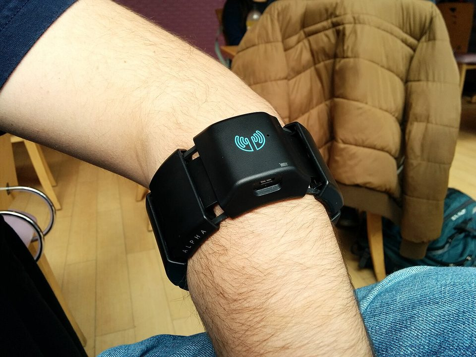

<!-- budget: 500 words -->

# Drive it

You need a Myo armband, conda and Chrome. Quit Myo Connect first if it is running.

```bash
git clone https://github.com/ajbarea/Hackathon.git && cd Hackathon
conda env create -f environment.yml          # once, about 5 minutes
conda activate jackal                        # in every new terminal
python examples/lever.py <your name>
```

That one command:

1. **Connects to the Myo**: our team's band by default; add `--addr nearest` for any other. On a
   Mac, allow Bluetooth for your terminal if asked.
2. **Calibrates you, the first time only** (about 2.5 minutes). Put the band on snugly, on the thickest
   part of your forearm, and wait 2 minutes for it to warm up. Then hold six poses as it prompts you.
   Your calibration is saved in `data/<your name>-lever`.
3. **Opens the sim in your browser and drives.** Pick a course (bottom right). Hold your arm forward and
   level for the countdown, then raise it once to start.
4. **Ctrl+C ends a drive.** Then press Enter to drive again, `r` to recalibrate, `t` to tune the turns,
   or `q` to quit.

Next time, the same command skips straight to driving. Recalibrate whenever the band comes off.

## How you drive

<figure class="myo-photo" markdown>
{ width="960" height="720" loading="lazy" }
<figcaption>A Myo on the thickest part of the forearm: its motion sensor reads the arm's angle, its eight
muscle (EMG) sensors the fist. Photo: <a href="https://www.flickr.com/people/23526149@N00">Antonio Zugaldia</a>,
<a href="https://creativecommons.org/licenses/by/2.0/">CC BY 2.0</a>, via
<a href="https://commons.wikimedia.org/wiki/File:Trying_the_@thalmic_Myo_armband,_can%27t_wait_to_experiment_with_it._Hat_tip_@juano2310_(12660932383).jpg">Wikimedia Commons</a>.</figcaption>
</figure>

Your forearm is a lever pivoting at the elbow (blue: the band):

<div class="pose-grid">
<figure class="pose"><svg viewBox="0 0 160 120" aria-hidden="true" focusable="false"><line class="ref" x1="12" y1="70" x2="150" y2="70"/><line class="arm" x1="40" y1="70" x2="125.0" y2="70.0"/><line class="band" x1="55.3" y1="70.0" x2="74.0" y2="70.0"/><circle class="joint" cx="40" cy="70" r="7"/><circle class="joint" cx="125.0" cy="70.0" r="8"/><path class="move" d="M98,92 H128"/><polygon class="tip" points="128,87 136,92 128,97"/></svg><figcaption><strong>Forward, level</strong>Goes; lower it to go faster</figcaption></figure>
<figure class="pose"><svg viewBox="0 0 160 120" aria-hidden="true" focusable="false"><line class="ref" x1="12" y1="70" x2="150" y2="70"/><line class="arm" x1="40" y1="70" x2="75.0" y2="9.4"/><line class="band" x1="46.3" y1="59.1" x2="54.0" y2="45.8"/><circle class="joint" cx="40" cy="70" r="7"/><circle class="joint" cx="75.0" cy="9.4" r="8"/><path class="move" d="M74,70 A34,34 0 0 0 57.0,40.6"/></svg><figcaption><strong>Raised from the elbow</strong>Stops</figcaption></figure>
<figure class="pose"><svg viewBox="0 0 160 120" aria-hidden="true" focusable="false"><circle class="arm" cx="80" cy="66" r="24" style="stroke-width:4"/><circle class="band" cx="80" cy="66" r="31" style="stroke-width:7;fill:none"/><circle class="joint" cx="80" cy="66" r="5"/><path class="move" d="M62,24 A44,44 0 0 0 36,52"/><polygon class="tip" points="31,47 36,58 42,49"/><path class="move" d="M98,24 A44,44 0 0 1 124,52"/><polygon class="tip" points="129,47 124,58 118,49"/></svg><figcaption><strong>Rolled left or right</strong>Turns</figcaption></figure>
<figure class="pose"><svg viewBox="0 0 160 120" aria-hidden="true" focusable="false"><line class="ref" x1="12" y1="70" x2="150" y2="70"/><line class="arm" x1="40" y1="70" x2="110.6" y2="107.6"/><line class="band" x1="52.7" y1="76.8" x2="68.3" y2="85.0"/><circle class="joint" cx="40" cy="70" r="7"/><circle class="joint" cx="110.6" cy="107.6" r="8"/><path class="move" d="M74,70 A34,34 0 0 1 70.0,86.0"/></svg><figcaption><strong>Tipped down</strong>Reverses</figcaption></figure>
<figure class="pose"><svg viewBox="0 0 160 120" aria-hidden="true" focusable="false"><rect class="fist" x="46" y="34" width="68" height="48" rx="14"/><line class="ref" x1="63" y1="34" x2="63" y2="56" style="stroke-dasharray:none"/><line class="ref" x1="80" y1="34" x2="80" y2="56" style="stroke-dasharray:none"/><line class="ref" x1="97" y1="34" x2="97" y2="56" style="stroke-dasharray:none"/><path class="arm" d="M50,72 Q72,64 94,72" style="stroke-width:7"/><rect class="bandfill" x="58" y="88" width="44" height="14" rx="3"/><text class="timer" x="80" y="116" text-anchor="middle">0.4 s</text></svg><figcaption><strong>Firm fist, held 0.4 s</strong>Brakes</figcaption></figure>
</div>

Relaxing your hand never moves the robot, so driving is not tiring.

## If something goes wrong

| What you see | Fix |
|---|---|
| `CondaError: Run 'conda init'` | Run `conda init zsh` once (or `conda init bash`), then open a new terminal |
| `No Myo found`, or stuck connecting | Plug the Myo into USB for a few seconds to wake it, unplug it, and move it. Close Myo Connect |
| Found once, then gone | It fell asleep: unplug it, put it on and keep moving while it connects |
| Still not found | Another laptop may hold it: stop `lever.py` there, then run `python examples/myo_check.py` |

More settings (`--expo`, `--vmax`, `--no-assist`, `--no-lag-comp`) and tuning are in
[`examples/MYO_LEVER.md`](https://github.com/ajbarea/Hackathon/blob/main/examples/MYO_LEVER.md).

## No armband?

Open the [live sim](sim/) and drive with W, A, S and D to see the courses. With the repo installed,
run `jackal-bridge --serve-site --open` for a local copy of the sim, then
`python examples/fake_myo_lsl.py --emit-cmd` drives it from synthetic EMG.
